# Car Infotainment UI

A touch-first concept for a car infotainment system that runs in the browser. It's inspired by BMW's **NBT** (iDrive 4/5) era: a dark widescreen layout with chrome details and an accent-lit selection state, plus the signature **split-screen** side panel. It's rebuilt for fingers instead of a click wheel, and it includes a mock **CarPlay** phone-projection mode.

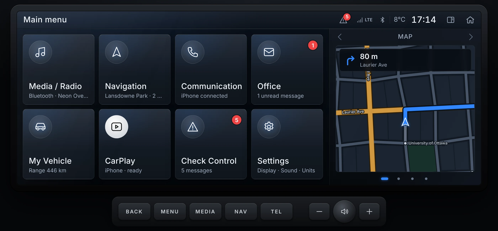

> No build step, no framework and no dependencies. Open `index.html` and drive.

---

## Contents

- [Why this exists](#why-this-exists)
- [Quick start](#quick-start)
- [Tour](#tour)
  - [Main menu and split screen](#main-menu-and-split-screen)
  - [Navigation](#navigation)
  - [Media / Radio](#media--radio)
  - [Communication](#communication)
  - [Office](#office)
  - [My Vehicle](#my-vehicle)
  - [Check Control](#check-control)
  - [Settings](#settings)
  - [CarPlay (mock)](#carplay-mock)
- [Controls and gestures](#controls-and-gestures)
- [URL options](#url-options)
- [Design principles](#design-principles)
- [Architecture](#architecture)
- [Customising](#customising)
- [Browser support](#browser-support)
- [Roadmap ideas](#roadmap-ideas)
- [History](#history)
- [Disclaimer](#disclaimer)

---

## Why this exists

I started this project years ago to sketch my idea of an *ideal* infotainment system. The original version tried to serve both click wheels and touch screens. Version 2 takes the visual language I liked most, BMW's NBT generation, and asks what it would look like if it were designed for touch from the start:

- Big, forgiving tap targets instead of a list built for a rotary controller.
- Direct manipulation: drag the map, scrub the track, swipe away a warning, drag the balance/fader point.
- Every screen still respects the NBT structure: a status bar, a left-hand menu rail and an optional split screen on the right.
- Phone projection treated as a first-class source, the way it is in modern cars.

## Quick start

```bash
git clone <this repo>
cd car_infotainment_ui
open index.html            # macOS. Or just double-click it.
```

That's it. Everything runs from `file://`; no server is required. If you prefer one:

```bash
python3 -m http.server 8080   # then visit http://localhost:8080
```

The design canvas is a fixed **1280 × 480** (a 10.25" automotive widescreen) and scales to fit any window. Press **K** to drop the bezel and hardware keys if you're running it on an actual wide display.

---

## Tour

### Main menu and split screen

Eight large tiles, each with a live subtitle (current track, ETA, range, unread count and so on). Badges show unread messages and active Check Control warnings.

The **split screen** on the right is a carousel with four panels: **Map**, **Entertainment**, **Onboard info** and **Weather**. Swipe it, tap the arrows or dots, or tap a panel to jump into the full app. Toggle it from the status bar at any time; the setting persists.

| Default (blue accent) | Classic red accent with the Entertainment panel |
| --- | --- |
| 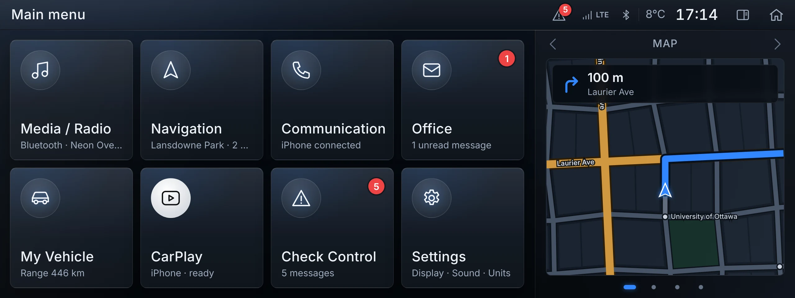 | 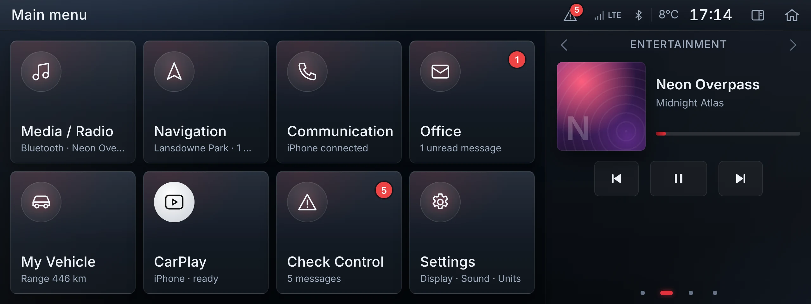 |

### Navigation

The original Google Maps embed is replaced by a **procedurally drawn city** loosely modelled on Ottawa. It has the Ottawa River, the Rideau Canal, bridges, Wellington, Laurier, Bank and Elgin, and points of interest like Parliament Hill, the ByWard Market and Lansdowne Park.

- **3D perspective** or flat 2D, with **heading-up** or north-up orientation.
- **Routing** with real shortest-path search over the street graph (Dijkstra, preferring arterials).
- **Turn-by-turn guidance** with distance to the next manoeuvre, the next street, ETA, remaining time and distance.
- Speed limit sign and current speed.
- **Drag** to pan, **pinch / wheel / double-tap** to zoom, then **Re-centre** to resume following.
- **Destination search** with an on-screen QWERTY keyboard and live filtering.
- Optional **spoken guidance** using the browser's speech engine.
- A **demo drive** runs continuously and picks a new destination after each arrival (you can turn it off in Settings → Demo).

| 3D guidance with the split screen | Full width |
| --- | --- |
| 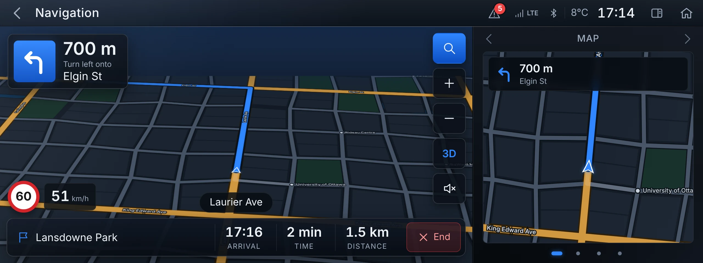 | 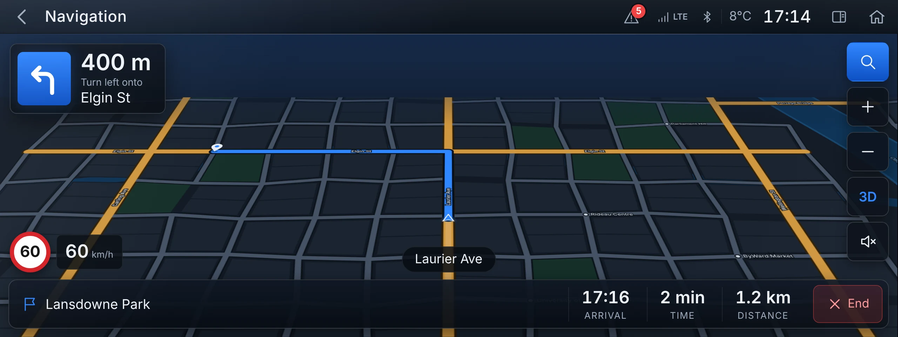 |

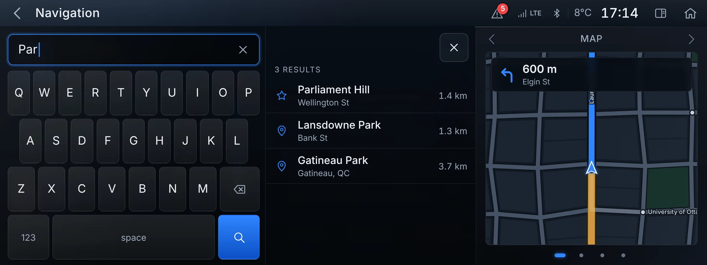

### Media / Radio

Four sources are on the left rail: **FM Radio**, **SiriusXM**, **USB** and **Bluetooth**.

- **Radio**: station name and RDS text, big seek buttons, six presets (tap to tune, **press and hold to store**) and a full station list.
- **Tracks**: generated album art, title, artist and album, a **scrubbable progress bar**, shuffle and repeat, and a track list with a live "now playing" equaliser.
- **Bluetooth** includes **Music**, **Podcasts** and **Books** queues, the same library CarPlay uses.
- The track list collapses automatically when the split screen is open.

| Bluetooth audio | FM radio with presets |
| --- | --- |
| 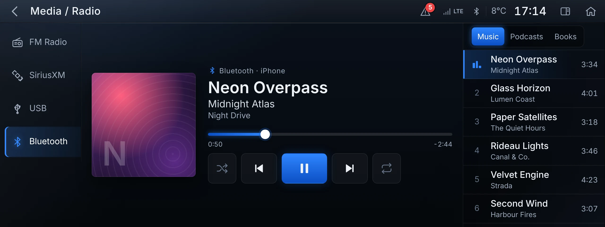 | 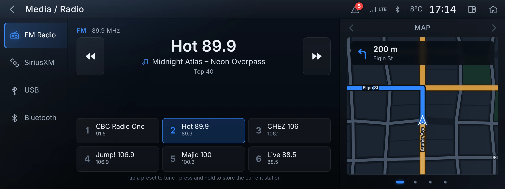 |

### Communication

Recents (missed calls highlighted, with a badge count), an alphabetised contact list with favourites, and a large keypad. Calls get a full-screen overlay with **mute**, **end** and **minimise**. Minimised calls live in a green pill in the status bar with a running timer. Incoming calls show **Accept / Decline** wherever you are, including inside CarPlay.

| Recents | Incoming call |
| --- | --- |
| 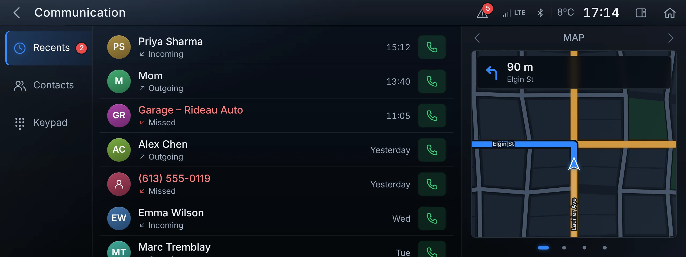 | 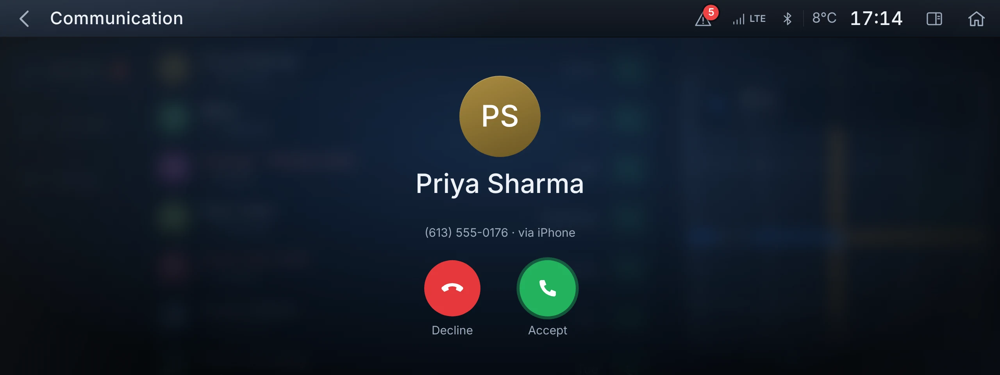 |

### Office

Messages with a two-pane reader, **Read aloud** (browser speech synthesis), **Call** and one-tap quick replies. The calendar shows today's agenda, and events with a known location get a **Navigate** button that starts guidance immediately.

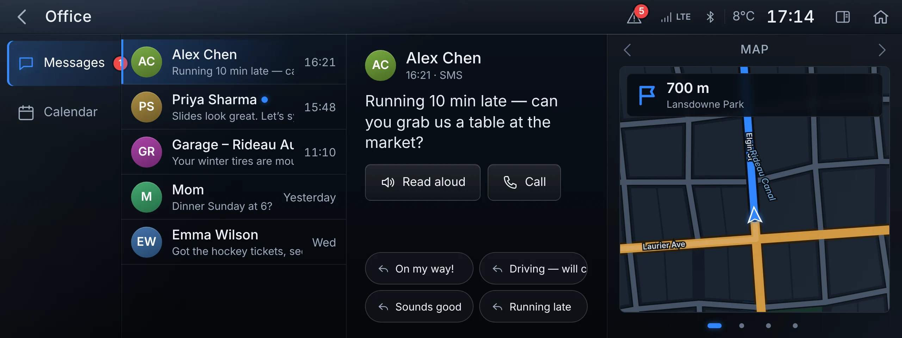

### My Vehicle

This is where the original project's OBD-II idea lives.

- **Vehicle status**: top-down car with per-tire pressure and temperature, fuel and range, doors, odometer and outside temperature.
- **Trip computer**: average consumption, average speed, distance, driving time, a consumption history chart and a **Reset trip** button.
- **Live data**: ring gauges for RPM, speed, coolant, battery voltage, engine load and throttle. They update in real time from the simulated drive.
- **Service**: remaining distance or time for oil, brakes, brake fluid, inspection and cabin filter.

| Status | Trip computer | Live data |
| --- | --- | --- |
| 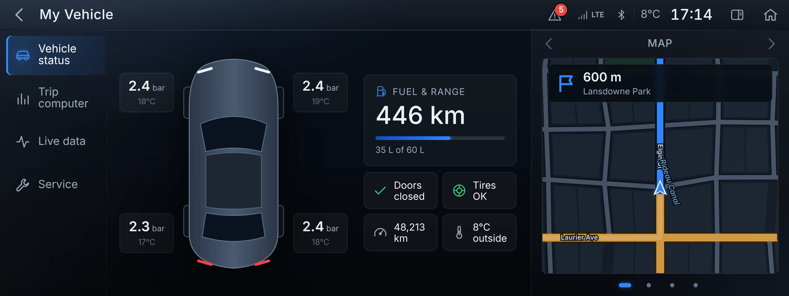 | 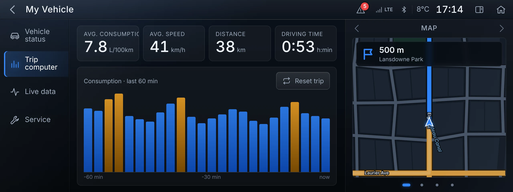 | 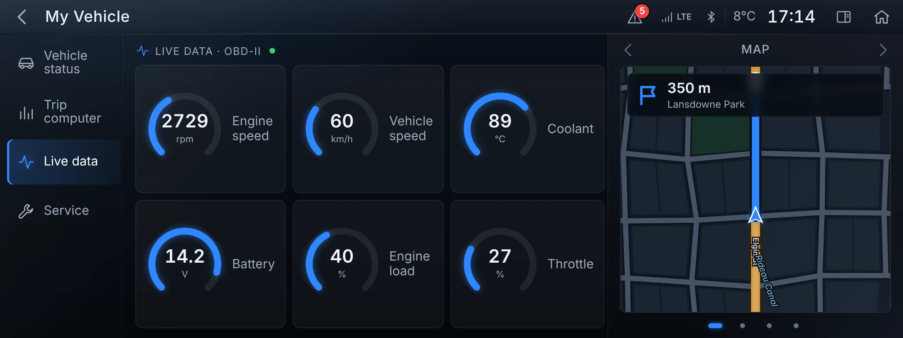 |

### Check Control

The original five vehicle warnings, now with severity colours (critical, warning, info), tap-to-expand guidance text, **swipe left to dismiss**, an ✕ button, and **Acknowledge all**. A "Restore demo messages" button brings them back.

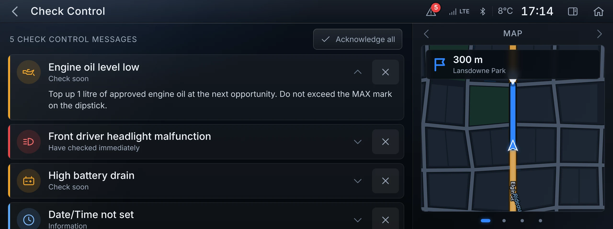

### Settings

Every setting is functional and persisted in `localStorage`.

| Category | What's there |
| --- | --- |
| **Display** | Brightness (real dimming overlay), accent colour (Blue, **Classic red**, Amber, Teal), split screen |
| **Sound** | Bass, mid, treble, a draggable **balance/fader pad**, speed-dependent volume |
| **General** | 24 h / 12 h clock, °C / °F, km / miles (updates every screen live) |
| **Navigation** | 3D map, heading-up / north-up, voice guidance |
| **Connections** | Phone status, enable CarPlay, launch CarPlay automatically |
| **Demo** | Demo drive, simulate an incoming call, add a Check Control message, simulate a text, reset everything |
| **About** | Version and shortcuts |

| Sound | Display (classic red) |
| --- | --- |
| 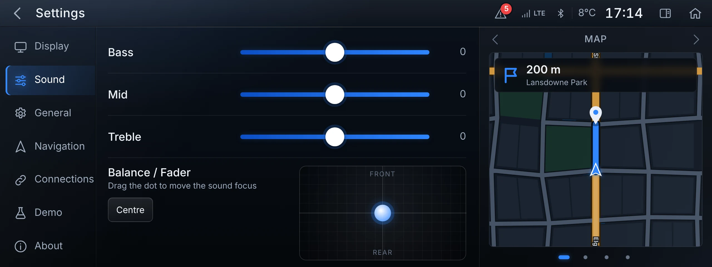 | 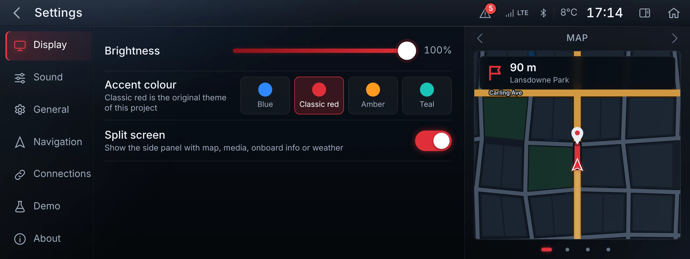 |

### CarPlay (mock)

Tap the **CarPlay** tile to "connect" your phone. A short connection animation hands the whole display over to a phone-projection UI with its own look, typography and behaviour:

- **Sidebar** with clock, signal, the three most recently used apps and a **home button**. Tap it to switch between the app grid and the dashboard; **long-press** it for the voice assistant overlay.
- **Dashboard**: live map with the next manoeuvre, a Now Playing card with controls and the next calendar event.
- **Maps**: guidance card, ETA, End, zoom and a destinations screen (Home, Work, calendar suggestion, recents). No keyboard while driving, as in the real thing.
- **Music / Now Playing / Podcasts / Audiobooks**: share the same playback engine as the native Media app.
- **Phone**: Favourites, Recents, Contacts and Keypad tabs, plus a CarPlay-style call screen.
- **Messages**: tap a conversation to have it read aloud, then reply by "dictation" or call back. New messages appear as banners.
- **Calendar**, plus **Settings** with Automatic / Dark / Light appearance, wallpapers and Driving Focus.
- A **Vehicle** app (or the MENU / MEDIA / NAV / TEL hardware keys) returns to the native system.

| App grid | Dashboard |
| --- | --- |
| 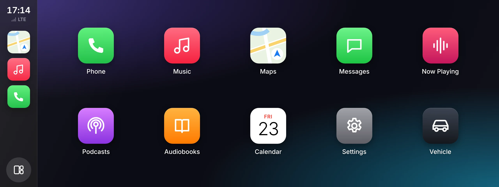 | 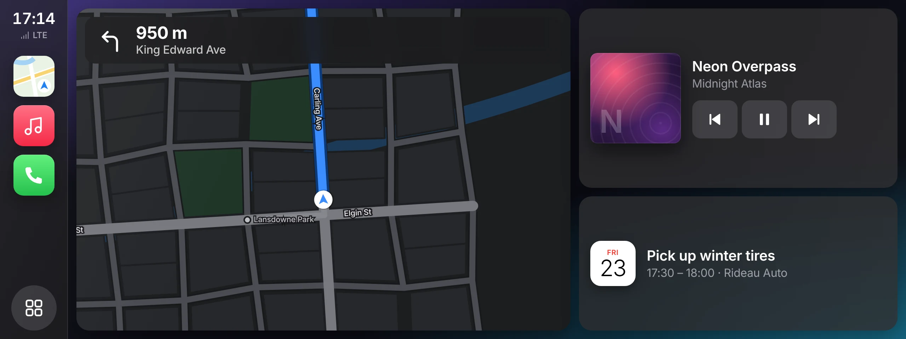 |

| Maps | Now Playing |
| --- | --- |
| 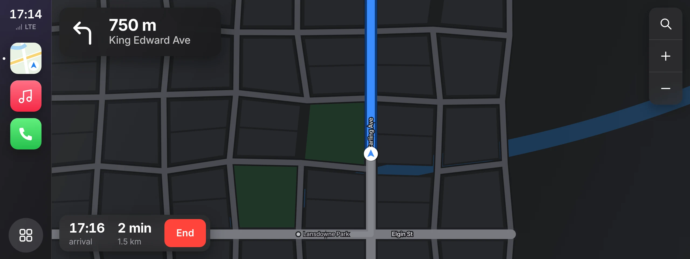 | 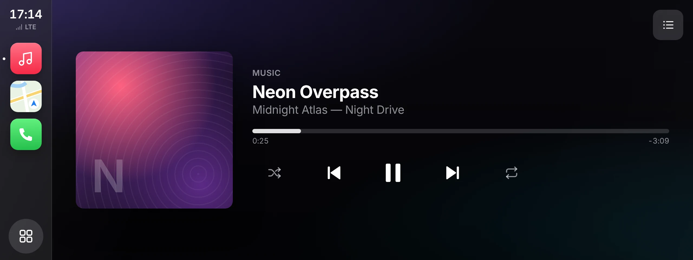 |

| Phone | Message read-out | Light appearance |
| --- | --- | --- |
| 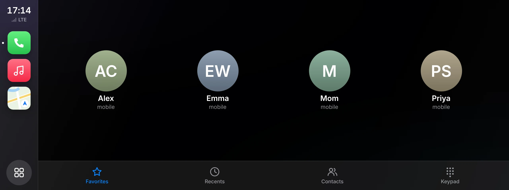 | 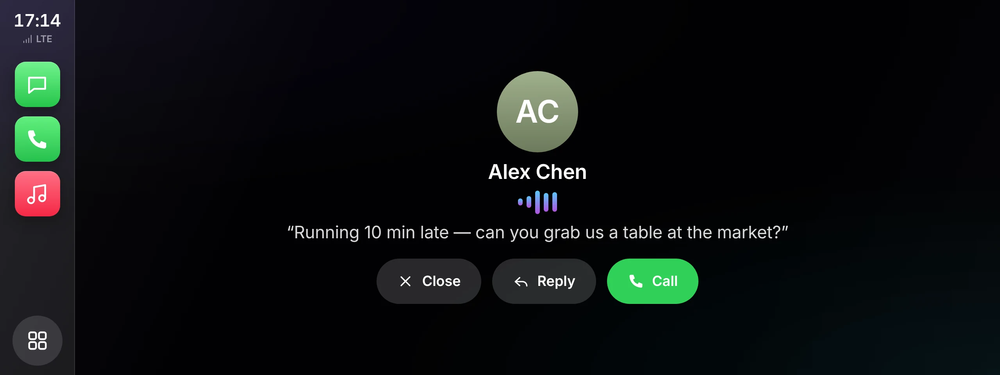 | 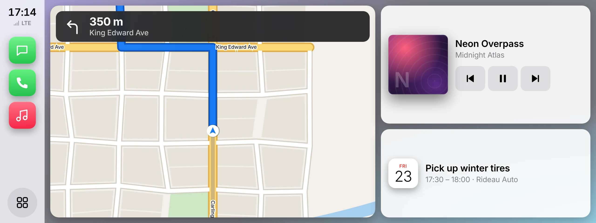 |

---

## Controls and gestures

### Touch / mouse

| Gesture | Where | Action |
| --- | --- | --- |
| Tap | Everywhere | Select |
| Drag | Map | Pan (stops following the car; tap **Re-centre** to resume) |
| Pinch, wheel, double-tap | Map | Zoom |
| Swipe left / right | Split screen | Change panel |
| Swipe right from the left edge | Any native screen | Back |
| Swipe left | Check Control row | Dismiss warning |
| Drag | Progress bars | Seek |
| Drag | Balance/fader pad | Move sound focus |
| Press and hold | Radio preset | Store the current station |
| Long-press | CarPlay home button | Voice assistant |
| Drag | Any list (mouse) | Scrolls like touch |

### Hardware keys (below the screen)

| Key | Action |
| --- | --- |
| **BACK** | Back (native or CarPlay) |
| **MENU** | Native main menu (leaves CarPlay) |
| **MEDIA / NAV / TEL** | Jump straight to that native app (leaves CarPlay) |
| **− / 🔊 / +** | Volume down / mute / volume up (hold to repeat) |

### Keyboard

| Key | Action |
| --- | --- |
| `Esc` / `Backspace` | Back |
| `↑` / `↓` (or `+` / `−`) | Volume |
| `K` | Toggle kiosk mode (no bezel, fills the window) |

## URL options

| Parameter | Effect |
| --- | --- |
| `?kiosk` | Start in kiosk mode, which is ideal for a real 1280 × 480 display or a Raspberry Pi |
| `?start=carplay` | Launch straight into CarPlay |
| `?start=nav` | Open a native screen on launch: `media`, `nav`, `tel`, `office`, `vehicle`, `alerts`, `settings` |

Parameters combine: `index.html?kiosk&start=nav`.

---

## Design principles

These carry over from v1 and have been sharpened:

1. **The screen controls infotainment, not the car.** Media, navigation, communication and vehicle information only. Climate stays on physical knobs, because knobs are still the most usable control for it while driving.
2. **Touch targets are large.** The minimum is about 48 px on the 1280 × 480 canvas, which is roughly 10 mm on a 10.25" panel. Primary actions (play, call, end guidance) are larger still.
3. **One accent colour carries state.** Selection, progress and the route all use the same accent. Red remains available because it's easier on the eyes at night, as the original README argued.
4. **Glanceable first.** Big numerals for distance, ETA and speed. Secondary detail is smaller and dimmer.
5. **Hardware keys always work.** Whatever is on screen, BACK / MENU / NAV / volume behave predictably, including inside CarPlay.
6. **Projection is a guest.** CarPlay takes over the display but never traps you. The car's own keys and a Vehicle app always get you back.

## Architecture

```
index.html               Shell, hardware keys and an inline SVG icon sprite (80+ icons)
assets/
├── css/
│   ├── app.css          Native NBT-style UI: tokens, layout, components, screens
│   └── carplay.css      CarPlay mock: its own tokens and light/dark themes
└── js/
    ├── core.js          Helpers, event bus, persisted Settings, formatting/units,
    │                    and the fake data sources: Media, Phone, Messages,
    │                    Calendar, Alerts (Check Control), Vehicle
    ├── map.js           World (procedural city + Path2D geometry + Dijkstra routing),
    │                    Nav (simulated drive, manoeuvres, ETA, voice prompts),
    │                    MapView (canvas renderer used by 4 different maps)
    ├── app.js           Native UI: router, status bar, split screen, all screens,
    │                    call overlay, volume HUD, toasts
    ├── carplay.js       CarPlay: sidebar, screens, call UI, banners, voice overlay
    └── main.js          Boot: scaling, hardware keys, keyboard, render loop
docs/screenshots/        Images used in this README
```

**How it fits together**

- **Plain scripts, no modules.** These are loaded in order, so the project works straight from `file://`.
- **One event bus.** Data sources emit `media`, `call`, `nav`, `alerts`, `messages`, `settings` and `volume`. Each UI subscribes and re-renders only what it owns, which is why the native screens, the split screen and CarPlay all stay in sync.
- **One render loop.** `requestAnimationFrame` advances the simulated drive and redraws only the map views that are currently visible. It emits `navtick` four times a second for text overlays.
- **Fixed design canvas.** Everything is laid out in CSS pixels on a 1280 × 480 canvas, and `#device` is scaled with a CSS transform to fit the window. Pointer maths divides by `UI.scale`.
- **Maps.** Static geometry is built once into `Path2D` objects, so each frame is just a handful of `stroke()`/`fill()` calls. The 3D effect is a CSS `perspective` + `rotateX` on an oversized canvas, with a sky gradient behind it.
- **Theming.** The accent colour is a CSS custom property switched by `data-accent` on `#screen`. Glows and tints are derived with `color-mix()`.

## Customising

**Add a native screen**
1. Add a title to `TITLES` in `app.js` (this creates the `<section>` automatically).
2. Create `VIEWS.myscreen = (() => { const el = V('myscreen'); …; return { show() {} }; })();`
3. Link to it with any element carrying `data-go="myscreen"` (for example, a new home tile).

**Add an accent colour**
Add a rule in `app.css`:
```css
#screen[data-accent="purple"] { --accent: #9b6bff; --accent-2: #5a2fc2; }
```
Then add `['purple', 'Purple']` to the swatch list in the Settings → Display pane.

**Change the data**
Stations, tracks, contacts, messages, calendar events, alerts and vehicle values all live at the top of their modules in `core.js`. Points of interest and street names are in `map.js` (`World.pois`, `majorRows`, `majorCols`, `rowNames`, `colNames`).

**Add a CarPlay app**
Add an entry to `APPS` and `ORDER` in `carplay.js`, then a screen function `S.myapp = () => '…html…'`.

## Browser support

Recent **Chrome, Edge, Safari and Firefox**. It uses `color-mix()`, `backdrop-filter`, `Path2D` and Pointer Events. Speech features (read aloud, voice guidance) depend on the browser's `speechSynthesis` support. Fonts come from Google Fonts (Barlow Semi Condensed and Inter) and fall back to system fonts offline.

## Roadmap ideas

- Real map tiles (MapLibre GL) behind the same overlay UI
- Android Auto–style projection mode alongside CarPlay
- Actual OBD-II data over Web Serial / Web Bluetooth with an ELM327 adapter
- Day/night palettes tied to time or ambient light
- Physical rotary-controller support (arrow keys + Enter) as an optional input layer
- French localisation

## History

- **v1 (2017):** Bootstrap 3 + jQuery prototype with four cards (Entertainment, Navigation via a Google Maps embed, Notifications, Settings) and a red-on-black theme.
- **v2:** a complete rewrite in vanilla HTML/CSS/JS. It adds the NBT-style widescreen layout, split screen, touch gestures, a procedural map with routing and guidance, communication, office, vehicle data, working settings and a CarPlay mock. The original red theme survives as **Classic red**.

## Disclaimer

This is a personal design concept. It is **not affiliated with, endorsed by or connected to BMW AG or Apple Inc.** "BMW", "iDrive", "NBT", "CarPlay" and "SiriusXM" are trademarks of their respective owners and are used only descriptively. All icons and album art are original, generated artwork. Every contact, message, station, track, route and vehicle reading is simulated.
